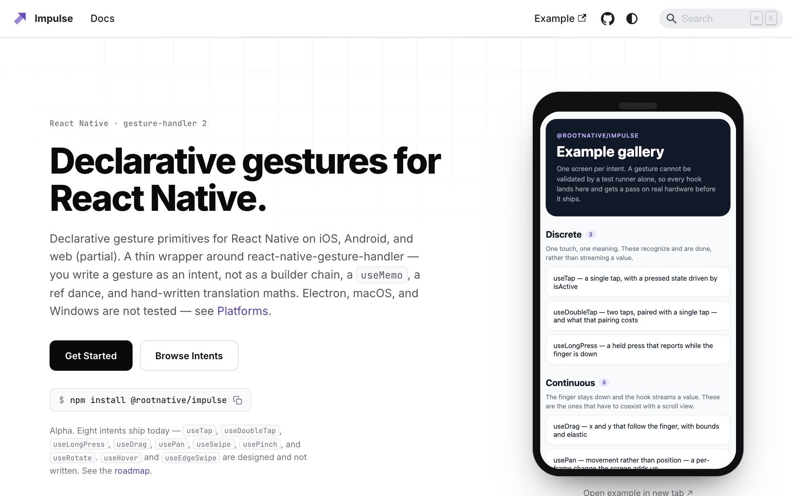
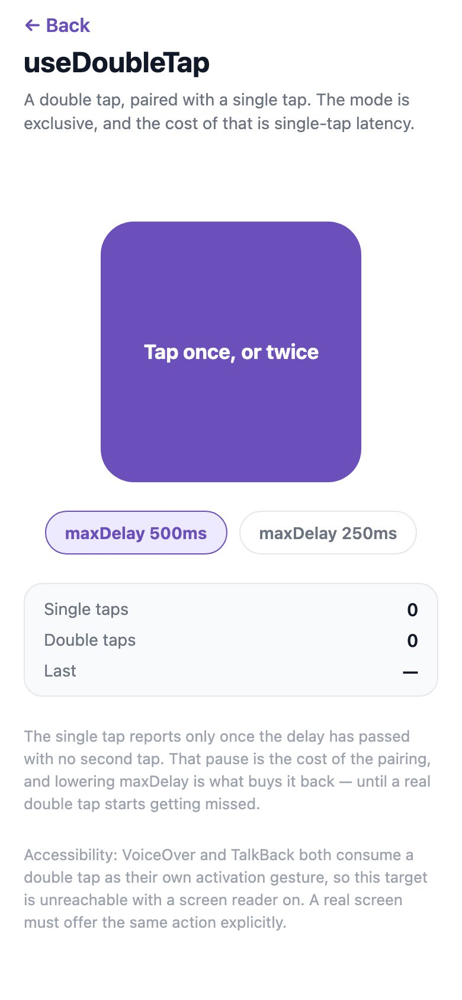
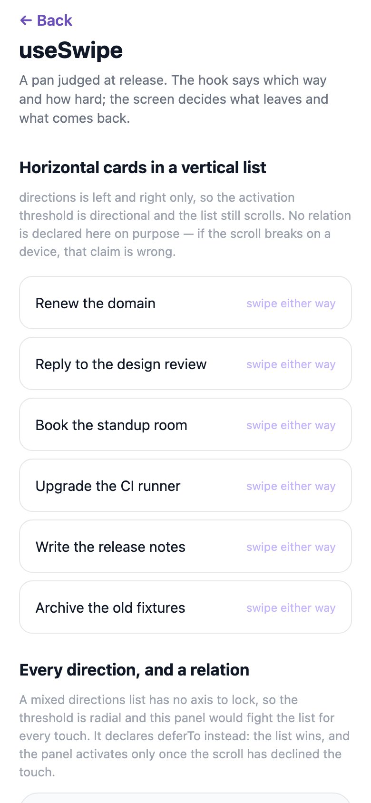
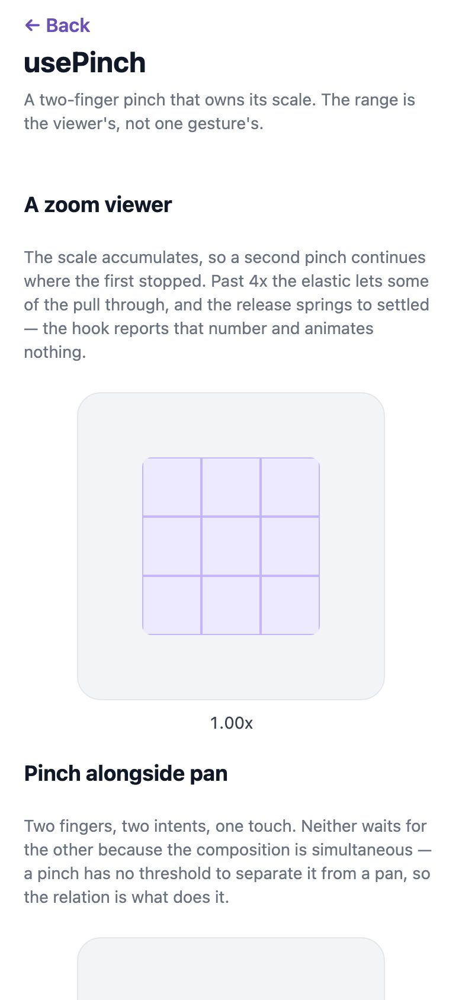
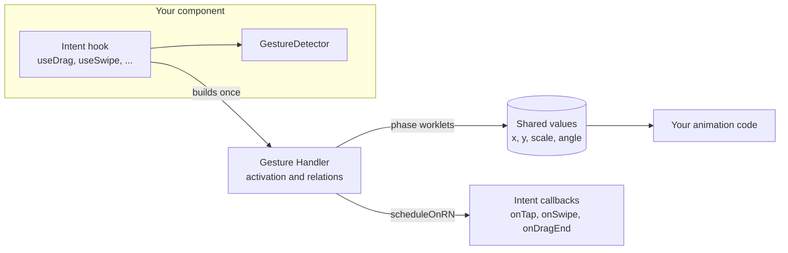

<p align="center">
  <a href="https://rootnative.github.io/impulse/">
    <picture>
      <source media="(prefers-color-scheme: dark)" srcset="assets/brand/impulse-mark-dark.svg" />
      
    </picture>
  </a>
</p>

<h1 align="center">Impulse</h1>

<p align="center">
  Declarative gestures for React Native, on iOS, Android, and the web.<br />
  A gesture is an intent, such as <code>useSwipe</code> or <code>usePinch</code>, not a builder chain.
</p>

<p align="center">
  <a href="https://github.com/rootnative/impulse/actions/workflows/ci-build.yml"></a>
  <a href="https://github.com/rootnative/impulse/actions/workflows/deploy-web.yml"></a>
  <a href="https://www.npmjs.com/package/@rootnative/impulse"></a>
  
  
  
  <a href="LICENSE"></a>
</p>

<p align="center">
  <a href="https://rootnative.github.io/impulse/example/"><b>Open the live demo</b></a>
  ·
  <a href="#-try-it">Try it</a>
  ·
  <a href="#-quick-start">Quick start</a>
  ·
  <a href="https://rootnative.github.io/impulse/introduction/">Documentation</a>
  ·
  <a href="https://rootnative.github.io/impulse/llms-full.txt">LLM docs</a>
</p>

<p align="center">
  <picture>
    <source media="(prefers-color-scheme: dark)" srcset="assets/docs/screenshots/docs-home-dark.jpg" />
    
  </picture>
</p>

> **Status:** `0.0.0-alpha.2`, an alpha. Eight intent hooks ship, with
> composition and coexistence. `useHover` and `useEdgeSwipe` are not written
> yet. Every intent was checked on an iOS simulator and an Android emulator.
> Nobody has tested the feel of a gesture yet.

## ✨ Features

| Feature | What it does |
| --- | --- |
| **Intents, not mechanisms** | One hook for each intent: tap, double tap, long press, drag, pan, swipe, pinch, and rotate. You don't set activation criteria by hand. |
| **Composition as data** | `useGestures([tap, doubleTap, pan], { mode: 'race' })` reads from left to right. A composed result can compose again. |
| **Three coexistence options** | Each hook takes `alongside`, `blocks`, and `deferTo`. Each option maps to exactly one Gesture Handler relation. |
| **Stable gesture identity** | An inline callback never rebuilds the gesture, so `<GestureDetector>` doesn't attach it again in the middle of a drag. A test pins this. |
| **The callback name states its thread** | `onBegin`, `onUpdate`, and `onFinalize` are worklets. `onTap`, `onSwipe`, and `onDragEnd` run on the JS thread, and Impulse owns the boundary. |
| **Payloads for each intent** | A drag reports `{ translation, velocity, absolute, settled }`, not the flat fields of Gesture Handler. |
| **Shared values out, no animation in** | Each hook returns shared values and a gesture. You animate them with the library that you already use. |
| **Accessibility, stated** | The docs page of each intent names its fallback for a screen reader and a keyboard. |
| **Web behaviour, stated** | The docs say what works in a browser, and what nobody has checked. |
| **Escape hatches** | `useRawGesture` gives you the mechanism. `@rootnative/impulse/gesture-handler` re-exports Gesture Handler, so Impulse stays your only gesture import. |
| **One subpath for each hook** | `@rootnative/impulse/drag` ships only `useDrag`. The package has no side effects at import. |
| **A Jest preset** | `@rootnative/impulse/jest-preset` sets up the mocks in one line. |

## 🖐️ The intent hooks

| Hook | What it reports | Web |
| --- | --- | --- |
| [`useTap`](https://rootnative.github.io/impulse/use-tap/) | A single tap, and `isActive` for the pressed state | Works under a mouse |
| [`useDoubleTap`](https://rootnative.github.io/impulse/use-double-tap/) | Two taps, paired with a single tap | Works under a mouse |
| [`useLongPress`](https://rootnative.github.io/impulse/use-long-press/) | A press held past a duration, while the finger is down | Works under a mouse |
| [`useDrag`](https://rootnative.github.io/impulse/use-drag/) | An `x` and a `y` that follow the finger, with bounds and elastic | Works under a mouse |
| [`usePan`](https://rootnative.github.io/impulse/use-pan/) | The movement of each frame. Your screen owns the position. | Not verified |
| [`useSwipe`](https://rootnative.github.io/impulse/use-swipe/) | A pan judged at release: which way, and how hard | Not verified |
| [`usePinch`](https://rootnative.github.io/impulse/use-pinch/) | A two-finger pinch that owns its scale | Not verified |
| [`useRotate`](https://rootnative.github.io/impulse/use-rotate/) | A two-finger rotation that owns its angle, in degrees | Not verified |
| `useHover`, `useEdgeSwipe` | Designed, not written | — |

## 📱 Try it

<p align="center">
  
  &nbsp;
  
  &nbsp;
  
</p>

<table>
  <tr>
    <th width="50%">In a browser</th>
    <th width="50%">On a phone</th>
  </tr>
  <tr>
    <td align="center">
      <a href="https://rootnative.github.io/impulse/example/"><b>rootnative.github.io/impulse/example</b></a>
      <br /><br />
      One screen for each intent.<br />
      You don't need an install or an account.
    </td>
    <td align="center">
      Clone this repository, then run<br />
      <code>pnpm install</code> and <code>pnpm run example</code>.
      <br /><br />
      Scan the QR code in the terminal with <b>Expo Go</b> for SDK 58.
    </td>
  </tr>
</table>

> [!NOTE]
> A browser has a mouse, not fingers. Only `useTap`, `useDoubleTap`,
> `useLongPress`, and `useDrag` were checked in a desktop browser. Use a phone
> to try the pinch, the rotation, and the swipe.

## 🚀 Quick start

```bash
npx expo install @rootnative/impulse react-native-gesture-handler react-native-reanimated react-native-worklets
```

`npx expo install` picks the peer versions that match your Expo SDK. Expo adds
the worklets Babel plugin for you. In a bare React Native app, add
`react-native-worklets/plugin` as the last Babel plugin. Then run
`npx pod-install` for iOS.

Render `<GestureHandlerRootView>` above every component that uses a gesture:

```tsx
import { GestureHandlerRootView } from 'react-native-gesture-handler'

export default function App() {
  return (
    <GestureHandlerRootView style={styles.root}>
      <Navigation />
    </GestureHandlerRootView>
  )
}

const styles = StyleSheet.create({
  root: { flex: 1 },
})
```

> [!WARNING]
> Without the root view, a gesture never fires. In development on iOS and
> Android, Gesture Handler 3 throws an error that names the root view. On web
> and in a release build, nothing throws and nothing warns. If a gesture does
> nothing at all, check the root view first.

Then attach a gesture:

```tsx
import { GestureDetector, useTap } from '@rootnative/impulse'

function Card() {
  const tap = useTap({ onTap: () => select() })

  return (
    <GestureDetector gesture={tap.gesture}>
      <View style={styles.card} />
    </GestureDetector>
  )
}
```

> [!TIP]
> Import one hook from its subpath, such as `@rootnative/impulse/drag`. Then an
> app that uses one gesture doesn't ship the set.

## 💡 Why Impulse

Gesture Handler is a good library. It gives you **mechanisms**: activation
criteria, gesture relations, and state machines. It leaves each **intent** to
you. So each app builds swipe to dismiss, double tap, and pinch from `Pan` and
its own maths again. Each copy gets the traps wrong in its own way.

The same horizontal drag inside a vertical scroll view, twice:

```tsx
// Gesture Handler
const x = useSharedValue(0)
const start = useSharedValue(0)

const pan = useMemo(
  () =>
    Gesture.Pan()
      .activeOffsetX([-10, 10])
      .failOffsetY([-5, 5])
      .requireExternalGestureToFail(scrollRef)
      .onStart(() => {
        start.value = x.value
      })
      .onUpdate((e) => {
        x.value = start.value + e.translationX
      })
      .onEnd((e) => {
        runOnJS(commit)(e.translationX > 100)
      }),
  [],
)
```

```tsx
// Impulse
const drag = useDrag({
  axis: 'x',
  deferTo: scrollRef,
  onDragEnd: (e) => commit(e.translation.x > 100),
})
```

`drag.x` is a shared value that keeps its position across gestures, so the
`start.value` step is gone. `deferTo` names the relation by what it does. The
step to the JS thread is the job of Impulse, not yours.

## 🧭 How it works



- **The gesture is built once.** An inline callback goes through a ref, so a
  new render doesn't make a new gesture.
- **The callback name states its thread.** A phase callback runs on the UI
  thread. An intent callback runs on the JS thread, and Impulse crosses the
  boundary for you.
- **Impulse detects. It doesn't animate.** It ships no springs, no
  transitions, and no components. A bridge to
  [`@rootnative/inertia`](https://www.npmjs.com/package/@rootnative/inertia) is
  planned as an optional subpath, and Impulse will never require an animation
  library.

### Impulse or `@rootnative/inertia-gestures`?

Both build on Gesture Handler, and both ship a `useDrag`, a `usePan`, and a
`useSwipe`. The names are the same, but the products are different.
[`@rootnative/inertia-gestures`](https://www.npmjs.com/package/@rootnative/inertia-gestures)
requires `@rootnative/inertia` and gives back an `animatedStyle` that already
knows the bounds and the spring back. Impulse requires no animation library and
gives back the gesture and its values. Use `-gestures` to make a `Motion.*`
component follow a finger. Use Impulse for the gesture itself.

## 📅 Runtime

Impulse is developed against **Expo SDK 58**: React 19.3.0, React Native
0.88.1, Gesture Handler 3.3.0, Reanimated 4.7.1, and Worklets 0.13.0. An Expo
SDK 57 app uses `0.0.0-alpha.1`.

| Peer | Range |
| --- | --- |
| `react` | `>=19.3.0 <20.0.0` |
| `react-native` | `>=0.88.0 <0.89.0` |
| `react-native-gesture-handler` | `>=3.3.0 <4.0.0` |
| `react-native-reanimated` | `>=4.7.0 <4.8.0` |
| `react-native-worklets` | `>=0.13.0 <0.14.0` |

The Reanimated and Worklets ranges are narrow on purpose. The two packages are
locked to each other, and a wider range lets a package manager pair versions
that don't install.

Impulse builds its gestures with the builder API of Gesture Handler
(`Gesture.Pan()`). Gesture Handler 3 marks that API as deprecated, and it still
runs it. A gesture from the Gesture Handler 3 hook API (`usePanGesture`)
doesn't compose with an Impulse gesture.

## 🗺️ Roadmap

| Milestone | State |
| --- | --- |
| 1. Composition and coexistence | Done. The gate (a horizontal `useDrag` in a vertical `ScrollView`, and a tap with a double tap) passed on Android and iOS. The feel is not tested. |
| 2. The intent set | Eight of ten intents ship. `useHover` and `useEdgeSwipe` are designed, not written. |
| 3. The Inertia bridge | Not started. `@rootnative/impulse/inertia` will turn a release payload into an Inertia release animation. |

Each milestone gate needs a pass on real hardware. A test runner can't tell
you if a horizontal drag inside a vertical `ScrollView` feels right. Read the
[roadmap](https://rootnative.github.io/impulse/roadmap/) for the detail.

## 🤖 Docs for AI agents

The package ships an [llms.txt](https://llmstxt.org/) file with the exact API
of its version: `node_modules/@rootnative/impulse/llms.txt`. The docs site
serves [llms.txt](https://rootnative.github.io/impulse/llms.txt), an overview,
and [llms-full.txt](https://rootnative.github.io/impulse/llms-full.txt), the
full API reference. The
[AI agents page](https://rootnative.github.io/impulse/ai/) explains the two
files.

## 📚 Documentation

| Page | Read it to |
| --- | --- |
| [Introduction](https://rootnative.github.io/impulse/introduction/) | Learn what Impulse does differently from raw Gesture Handler |
| [Installation](https://rootnative.github.io/impulse/installation/) | Install the peers, add the root view, and see the status of each platform |
| [Composition](https://rootnative.github.io/impulse/composition/) | Combine gestures with `useGestures` in race, simultaneous, or exclusive mode |
| [Coexistence](https://rootnative.github.io/impulse/coexistence/) | Choose between `alongside`, `blocks`, and `deferTo` next to a scroll view |
| [Threads and callbacks](https://rootnative.github.io/impulse/threads/) | Learn which callbacks are worklets and which run on the JS thread |
| [Raw gestures](https://rootnative.github.io/impulse/raw-gestures/) | Use `useRawGesture` when no intent fits |
| [Gesture Handler interop](https://rootnative.github.io/impulse/gesture-handler/) | Use a Gesture Handler primitive through `@rootnative/impulse/gesture-handler` |
| [Web behaviour](https://rootnative.github.io/impulse/web/) | See what each intent does in a browser, and what nobody has checked |
| [Testing](https://rootnative.github.io/impulse/testing/) | Test gestures in Jest with the preset |
| [Roadmap](https://rootnative.github.io/impulse/roadmap/) | See each milestone and its gate |

## 🧰 Tech stack

| Layer | Technology |
| --- | --- |
| Runtime | React 19.3, React Native 0.88, Expo SDK 58 |
| Gestures | `react-native-gesture-handler` 3.3 (the builder API), with Reanimated 4.7 and Worklets 0.13 as peers |
| Language | TypeScript 5, strict mode |
| Build | tsup (ESM output), Turborepo |
| Package manager | pnpm 10 |
| Tests | Jest 29, `@testing-library/react-native`, and the Gesture Handler Jest utilities |
| Docs | Docusaurus 3 |
| Delivery | GitHub Actions, GitHub Pages, and npm with trusted publishing |

## 🔧 Development

You need Node.js 24 (the version in `.nvmrc`) and pnpm 10.

```bash
git clone https://github.com/rootnative/impulse.git
cd impulse
pnpm install
```

| Command | What it does |
| --- | --- |
| `pnpm run build` | Builds the package with Turborepo |
| `pnpm run dev` | Builds in watch mode |
| `pnpm run typecheck` | Runs `tsc --noEmit` |
| `pnpm run test` | Runs Jest |
| `pnpm run lint` | Runs ESLint |
| `pnpm run example` | Starts the Expo dev server of the example app |
| `pnpm run docs:dev` | Starts the docs site |
| `pnpm run build:llms` | Writes `llms.txt` and `llms-full.txt` again after a docs change |
| `pnpm run check:versions` | Checks that each version reference agrees with the package |
| `pnpm run preflight` | Runs the full gate that CI runs before a release |

To run one test, name the package first:

```bash
pnpm --filter @rootnative/impulse test -- gestureIdentity
```

To start the example on one platform, run `pnpm run example:ios`,
`pnpm run example:android`, or `pnpm run example:web`.

<details>
<summary>Repository layout</summary>

| Path | What it is |
| --- | --- |
| [packages/core/](packages/core/) | `@rootnative/impulse`, the whole public surface |
| [docs/](docs/) | The Docusaurus site. Its build also carries the web build of the example app. |
| [example/](example/) | The Expo app, one screen for each intent. A pass on a device is a release requirement. |
| [scripts/](scripts/) | `build-llms.mjs`, `check-versions.mjs`, and `build-brand.mjs` |

Inside `packages/core/src`:

| Path | What it is |
| --- | --- |
| `intents/` | One file for each intent hook |
| `compose/` | `useGestures`, the only place that uses the `Race`, `Simultaneous`, and `Exclusive` of Gesture Handler |
| `relations/` | The resolution of `alongside`, `blocks`, and `deferTo` to the three relations of Gesture Handler |
| `raw/` | `useRawGesture`, the escape hatch |
| `internal/` | Not public. The shared memo helper, `useLatestCallback`, `useStableList`, and the dev warnings. |
| `gesture-handler/` | The re-exports of Gesture Handler, pinned to reference identity by a test |

</details>

## 🔒 Security

To report a vulnerability, read [SECURITY.md](SECURITY.md).

## 🙏 Credits

- [Gesture Handler](https://docs.swmansion.com/react-native-gesture-handler/)
  and [Reanimated](https://docs.swmansion.com/react-native-reanimated/) by
  Software Mansion recognise and run every gesture.

## 📄 Licence

[MIT](LICENSE) © 2026 Root Native
